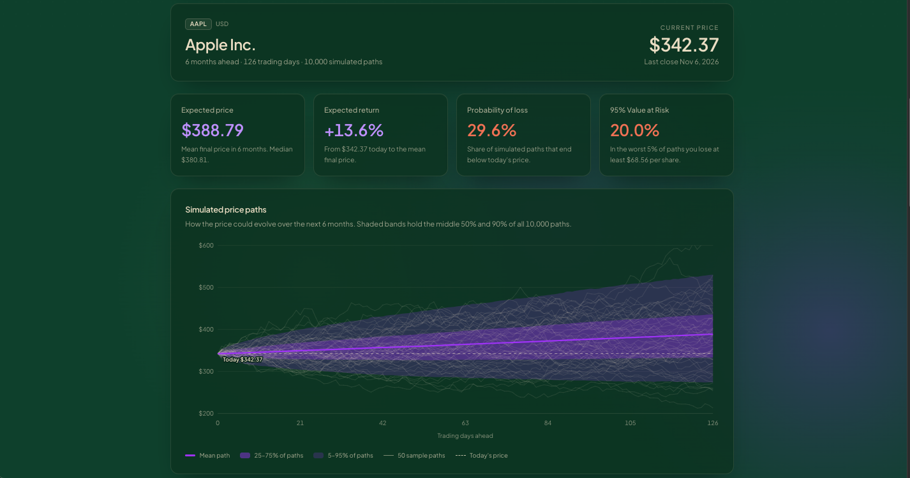
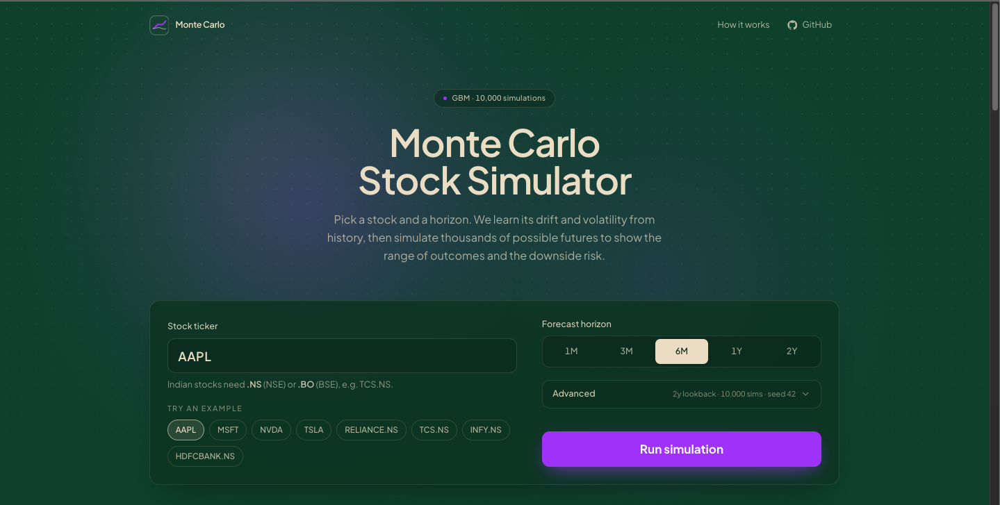
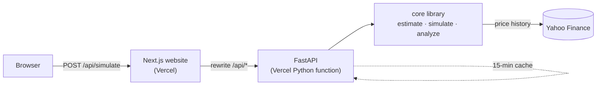
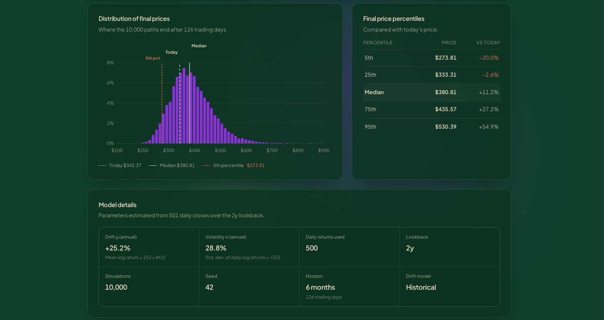

# Monte Carlo Stock Simulator

Forecast the range of possible prices for any US or Indian stock by simulating 10,000 geometric Brownian motion paths from its own price history.

[](https://www.python.org/)
[](https://fastapi.tiangolo.com/)
[](https://nextjs.org/)
[](https://www.typescriptlang.org/)
[](https://vercel.com/)
[](LICENSE)

### **[▶ Live demo: monte-carlo-stock-sim.vercel.app](https://monte-carlo-stock-sim.vercel.app)**

API: [monte-carlo-stock-api.vercel.app](https://monte-carlo-stock-api.vercel.app) · [interactive docs](https://monte-carlo-stock-api.vercel.app/docs)



## What it does

Enter a US or Indian ticker (e.g. `AAPL`, `RELIANCE.NS`) and a forecast horizon. The app downloads the stock's price history, estimates its drift and volatility, and simulates 10,000 GBM price paths to show the range of likely outcomes and the downside risk.

## Features

- **Live market data** from Yahoo Finance (US tickers and NSE `.NS` / BSE `.BO`)
- **Automatic parameter estimation**: drift and volatility from daily log returns
- **Vectorised simulation**: 10,000 paths in a single NumPy operation, seeded and reproducible
- **Risk metrics**: expected price, probability of loss, 95% Value at Risk, 5/25/50/75/95th percentile bands
- **Interactive charts**: fan chart of simulated paths and a histogram of final prices
- **Shareable URLs**: `?ticker=TCS.NS&horizon=1y` re-runs the same simulation
- **CLI** with rich terminal output and saved matplotlib charts
- **REST API** (FastAPI) with validation, consistent error codes and a result cache
- **Currency aware**: ₹ with Indian digit grouping for `.NS` / `.BO`, $ for US stocks



## How it works

Stock prices are modelled as **geometric Brownian motion**:

$$
dS_t = \mu S_t\,dt + \sigma S_t\,dW_t
$$

where $\mu$ is the annual drift, $\sigma$ the annual volatility and $W_t$ a Wiener process. Its exact solution gives the discretised step used by the simulator (no Euler approximation error):

$$
S_{t+\Delta t} = S_t \cdot \exp\left(\left(\mu - \tfrac{1}{2}\sigma^2\right)\Delta t + \sigma\sqrt{\Delta t}\,Z\right), \qquad Z \sim \mathcal{N}(0, 1)
$$

with $\Delta t = 1/252$ (one trading day). All $Z$ draws are generated at once as an `(n_sims, n_steps)` matrix and cumulatively summed in log space ([`core/simulate.py`](backend/core/simulate.py)).

**Parameter estimation** ([`core/estimate.py`](backend/core/estimate.py)) uses daily log returns $r_i = \ln(S_i / S_{i-1})$ over the lookback window (default 2 years), annualised with 252 trading days:

$$
\sigma = \operatorname{std}(r)\cdot\sqrt{252}, \qquad \mu = \bar{r}\cdot 252 + \tfrac{1}{2}\sigma^2
$$

The $+\tfrac{1}{2}\sigma^2$ term converts the mean *log* return into the arithmetic drift that GBM expects, so the $-\tfrac{1}{2}\sigma^2$ in the step cancels it and the median path follows the historical trend.

**Validation.** Under GBM the expected final price is

$$
\mathbb{E}[S_T] = S_0\, e^{\mu T}
$$

and the test suite checks that the mean of 10,000 simulated final prices lands within four standard errors of this value ([`tests/test_simulate.py`](backend/tests/test_simulate.py)), along with zero-volatility, reproducibility and shape checks.

**Risk metrics** ([`core/analyze.py`](backend/core/analyze.py)): probability of loss is the share of paths ending below $S_0$; 95% VaR is the loss, as a percentage of $S_0$, at the 5th percentile final price.

## Architecture



- **Two Vercel projects, one repo.** The website (`frontend/`) and the API (`backend/`) are deployed separately so each gets its native runtime: Next.js for the UI and a Python function for NumPy and pandas. The website rewrites `/api/*` to the API, so the browser only talks to one domain and no CORS setup is needed.
- **Response trimming.** A full result (10,000 paths reduced to percentile bands, 100 sample paths, every trading day) is about 1.3 MB of JSON. The API downsamples time series to at most 200 points and keeps 50 sample paths, bringing a typical response to about 110 KB ([`api/serialize.py`](backend/api/serialize.py)).
- **Caching.** Trimmed results are kept in an in-memory TTL cache for 15 minutes, keyed by ticker, horizon, lookback, simulation count and seed, so repeated and shared runs skip both Yahoo and the simulation ([`api/cache.py`](backend/api/cache.py)).

## Example

Same 6-month horizon, 2-year lookback, 10,000 simulations, seed 42:

| | AAPL | HDFCBANK.NS |
|---|---:|---:|
| Current price S₀ | \$342.37 | ₹788.25 |
| Drift μ (annual) | **25.2%** | **−1.9%** |
| Volatility σ (annual) | 28.8% | 20.2% |
| Expected price | \$388.79 (+13.6%) | ₹781.53 (−0.9%) |
| Probability of loss | 29.6% | 55.6% |
| 95% VaR | 20.0% | 22.1% |

Drift dominates the outcome: AAPL's strong historical trend pulls the whole distribution upward, so fewer than a third of paths end in a loss. HDFCBANK.NS has lower volatility, yet its slightly negative drift makes a loss more likely than not, and its VaR is higher. These figures depend on the run date, since the estimates come from the most recent two years of prices.



## Limitations

- **Constant volatility.** Real volatility clusters and spikes; GBM assumes one fixed $\sigma$.
- **Normal returns, no fat tails.** Log returns are Gaussian, so extreme moves are under-represented and VaR is likely optimistic.
- **Noisy historical drift.** A two-year mean return is a weak predictor of the future; small changes to the lookback can swing $\mu$ a lot.
- **No dividends, news or events.** Earnings, splits, dividends and macro shocks are not modelled.
- **Unofficial data source.** Yahoo Finance via `yfinance` is unofficial and can be rate-limited or change without notice.

This is an educational model, **not financial advice**.

## Run locally

Requires **Python 3.12+** and **Node 22+**.

**Backend** (from `backend/`):

```bash
python3 -m venv .venv && source .venv/bin/activate
```

```bash
pip install -r requirements-dev.txt
```

```bash
uvicorn api.main:app --reload
```

The API runs at http://127.0.0.1:8000 with docs at http://127.0.0.1:8000/docs.

**Frontend** (from `frontend/`, in a second terminal):

```bash
npm install
```

```bash
cp .env.example .env.local
```

```bash
npm run dev
```

Open http://localhost:3000. `.env.local` sets `BACKEND_URL=http://localhost:8000`, and Next.js proxies `/api/*` there. To try the UI without the backend, run `NEXT_PUBLIC_DEMO_MODE=true npm run dev` (serves a bundled sample response).

**CLI** (from `backend/`, venv active):

```bash
python cli.py --ticker AAPL --horizon 6m
```

```bash
python cli.py --ticker RELIANCE.NS --horizon 1y --lookback 5y --sims 20000 --no-show --json output/reliance.json
```

Charts are saved to `./output` as `<TICKER>_<horizon>_paths.png` and `<TICKER>_<horizon>_hist.png`. Run `python cli.py --help` for all options.

**Tests** (no network needed; Yahoo Finance is mocked):

```bash
cd backend && python -m pytest
```

```bash
cd frontend && npm run lint && npm test && npm run build
```

## API

Base URL: `https://monte-carlo-stock-api.vercel.app` · [Swagger docs](https://monte-carlo-stock-api.vercel.app/docs)

| Method | Path | Description |
|---|---|---|
| `GET` | `/` | Service info with links to the docs, health check and website |
| `GET` | `/api/health` | Health check, returns `{"status": "ok"}` |
| `POST` | `/api/simulate` | Run a simulation |

Request body for `POST /api/simulate`:

| Field | Type | Default | Notes |
|---|---|---|---|
| `ticker` | string | required | e.g. `AAPL`, `RELIANCE.NS`, `TCS.BO` |
| `horizon` | string | required | `<n><d\|w\|m\|y>`, e.g. `1w`, `3m`, `1y`; max `5y` |
| `lookback` | string | `2y` | `6mo`, `1y`, `2y` or `5y` |
| `n_sims` | integer | `10000` | 1,000 to 20,000 |
| `seed` | integer | `42` | non-negative |

```bash
curl -s -X POST https://monte-carlo-stock-api.vercel.app/api/simulate -H "Content-Type: application/json" -d '{"ticker": "AAPL", "horizon": "6m"}'
```

The response contains `metadata` (ticker, currency, company name, last date), `parameters` (`S0`, `mu`, `sigma`), `settings`, and `analysis` (final-price stats, `expected_return_pct`, `prob_below_start`, `var_95_pct`, percentile bands, mean path, sample paths, histogram).

Errors always have the shape `{"error": {"code": "...", "message": "..."}}`:

| Code | HTTP | When |
|---|---:|---|
| `invalid_ticker` | 404 | No price data for the symbol |
| `insufficient_data` | 422 | Too little history to estimate parameters |
| `invalid_input` | 422 | Request body fails validation |
| `data_unavailable` | 502 | Yahoo Finance could not be reached |
| `internal_error` | 500 | Unexpected server error |

## Project structure

```
.
├── backend/
│   ├── core/            # maths: data fetch, horizon parsing, estimation, GBM simulation, risk analysis
│   ├── api/             # FastAPI app: routes, schemas, response trimming, TTL cache
│   ├── tests/           # pytest suite (network mocked)
│   ├── cli.py           # terminal interface
│   ├── plots.py         # matplotlib charts for the CLI
│   ├── index.py         # Vercel entrypoint
│   └── render.yaml      # Render fallback deployment
├── frontend/
│   ├── app/             # Next.js layout, page, global styles, Open Graph image
│   ├── components/      # simulator form, results, fan chart, histogram
│   ├── lib/             # API client, types, formatting, chart helpers (with Vitest tests)
│   └── mocks/           # sample API response for demo mode
├── docs/images/         # screenshots
└── DEPLOY.md            # deployment guide
```

## Deployment

Both apps deploy to Vercel from this repository as two projects: the API with Root Directory `backend` (FastAPI preset) and the website with Root Directory `frontend` (Next.js preset), whose `BACKEND_URL` environment variable points at the API. Pushing to `main` redeploys both. [DEPLOY.md](DEPLOY.md) has the full click-by-click guide, verification steps, and a Render fallback in case Yahoo Finance blocks Vercel's servers.

## Roadmap

- Risk-free drift option (risk-neutral simulation)
- Backtesting: compare past forecasts with realised prices
- Fat-tailed returns (Student-t shocks)
- Multi-asset portfolios with correlated paths

## License

[MIT](LICENSE) © 2026 Lnvqntx
