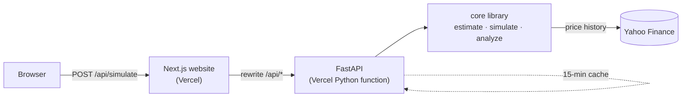
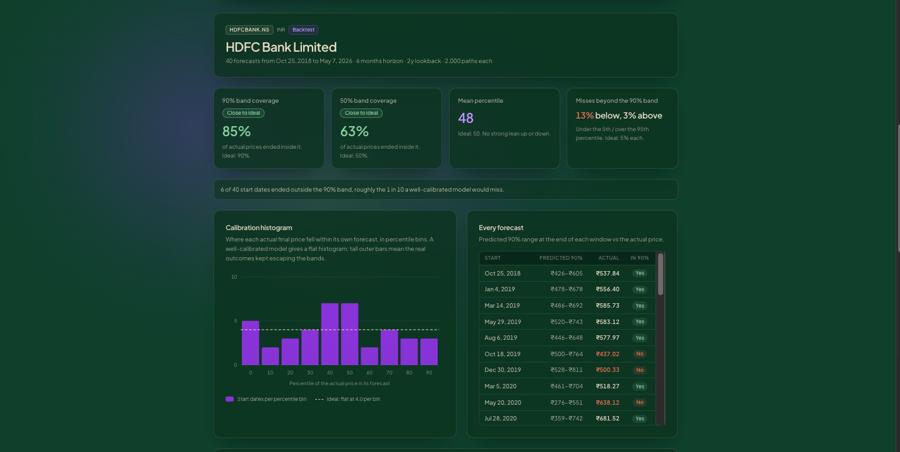

# Monte Carlo Stock Simulator

Forecast the range of possible prices for any US or Indian stock by simulating 10,000 geometric Brownian motion paths from its own price history.

[](https://www.python.org/)
[](https://fastapi.tiangolo.com/)
[](https://nextjs.org/)
[](https://www.typescriptlang.org/)
[](https://vercel.com/)
[](LICENSE)

### **[▶ Live demo: monte-carlo-stock-sim.vercel.app](https://monte-carlo-stock-sim.vercel.app)**

API: [monte-carlo-stock-api.vercel.app](https://monte-carlo-stock-api.vercel.app) · [interactive docs](https://monte-carlo-stock-api.vercel.app/docs)


## What it does

Enter a US or Indian ticker (e.g. `AAPL`, `RELIANCE.NS`) and a forecast horizon. The app downloads the stock's price history, estimates its drift and volatility, and simulates 10,000 GBM price paths to show the range of likely outcomes and the downside risk.

## Features

- **Live market data** from Yahoo Finance (US tickers and NSE `.NS` / BSE `.BO`)
- **Automatic parameter estimation**: drift and volatility from daily log returns
- **Two drift models**: historical drift (default) or risk-free drift, a risk-neutral baseline at the live 13-week T-bill rate (USD) or a per-currency default, with an optional override
- **Vectorised simulation**: 10,000 paths in a single NumPy operation, seeded and reproducible
- **Backtesting**: rerun the model from past start dates using only the prices known then, draw what actually happened over the fan, and measure how often the 50% and 90% bands held across up to 40 rolling windows (with a calibration histogram)
- **Risk metrics**: expected price, probability of loss, 95% Value at Risk, 5/25/50/75/95th percentile bands
- **Interactive charts**: fan chart of simulated paths and a histogram of final prices
- **Shareable URLs**: `?ticker=TCS.NS&horizon=1y` re-runs the same simulation (`&drift=risk_free&rate=4.5` for risk-free runs; `&mode=backtest&start=2025-05-01` or `&mode=backtest&test=rolling` for backtests)
- **CLI** with rich terminal output and saved matplotlib charts
- **REST API** (FastAPI) with validation, consistent error codes and a result cache
- **Currency aware**: ₹ with Indian digit grouping for `.NS` / `.BO`, $ for US stocks


## How it works

Stock prices are modelled as **geometric Brownian motion**:

$$
dS_t = \mu S_t\,dt + \sigma S_t\,dW_t
$$

where $\mu$ is the annual drift, $\sigma$ the annual volatility and $W_t$ a Wiener process. Its exact solution gives the discretised step used by the simulator (no Euler approximation error):

$$
S_{t+\Delta t} = S_t \cdot \exp\left(\left(\mu - \tfrac{1}{2}\sigma^2\right)\Delta t + \sigma\sqrt{\Delta t}\,Z\right), \qquad Z \sim \mathcal{N}(0, 1)
$$

with $\Delta t = 1/252$ (one trading day). All $Z$ draws are generated at once as an `(n_sims, n_steps)` matrix and cumulatively summed in log space ([`core/simulate.py`](backend/core/simulate.py)).

**Parameter estimation** ([`core/estimate.py`](backend/core/estimate.py)) uses daily log returns $r_i = \ln(S_i / S_{i-1})$ over the lookback window (default 2 years), annualised with 252 trading days:

$$
\sigma = \operatorname{std}(r)\cdot\sqrt{252}, \qquad \mu = \bar{r}\cdot 252 + \tfrac{1}{2}\sigma^2
$$

The $+\tfrac{1}{2}\sigma^2$ term converts the mean *log* return into the arithmetic drift that GBM expects, so the $-\tfrac{1}{2}\sigma^2$ in the step cancels it and the median path follows the historical trend.

**Historical vs risk-neutral drift.** By default the simulator uses the historical $\mu$ above, so paths extend the stock's past trend. With `drift = risk_free` it sets $\mu = r$, the annual risk-free rate, as in risk-neutral option pricing; $\sigma$ is still estimated from history and the historical $\mu$ is still returned for comparison ([`core/rates.py`](backend/core/rates.py)). The rate is chosen in this order:

1. a user override (`risk_free_rate`, a decimal between −0.05 and 0.25);
2. for USD stocks, the live 13-week T-bill yield from Yahoo's `^IRX` (3-second timeout, silent fallback);
3. a per-currency default: USD 3.70% (13-week T-bill), INR 5.35% (91-day T-bill), otherwise a generic 4.00%.

The response reports the rate and its source (`live ^IRX`, `default for INR`, `user override`, ...). The expected price becomes $S_0 e^{rT}$: a neutral baseline that isolates the spread due to volatility, not a forecast.

**Validation.** Under GBM the expected final price is

$$
\mathbb{E}[S_T] = S_0\, e^{\mu T}
$$

and the test suite checks that the mean of 10,000 simulated final prices lands within four standard errors of this value ([`tests/test_simulate.py`](backend/tests/test_simulate.py)), along with zero-volatility, reproducibility and shape checks. With risk-free drift the same check runs against $S_0 e^{rT}$ ([`tests/test_run_simulation.py`](backend/tests/test_run_simulation.py)).

**Risk metrics** ([`core/analyze.py`](backend/core/analyze.py)): probability of loss is the share of paths ending below $S_0$; 95% VaR is the loss, as a percentage of $S_0$, at the 5th percentile final price.

## Architecture



- **Two Vercel projects, one repo.** The website (`frontend/`) and the API (`backend/`) are deployed separately so each gets its native runtime: Next.js for the UI and a Python function for NumPy and pandas. The website rewrites `/api/*` to the API, so the browser only talks to one domain and no CORS setup is needed.
- **Response trimming.** A full result (10,000 paths reduced to percentile bands, 100 sample paths, every trading day) is about 1.3 MB of JSON. The API downsamples time series to at most 200 points and keeps 50 sample paths, bringing a typical response to about 110 KB ([`api/serialize.py`](backend/api/serialize.py)).
- **Caching.** Trimmed results are kept in an in-memory TTL cache for 15 minutes, keyed by ticker, horizon, lookback, simulation count, seed, drift model and rate override, so repeated and shared runs skip both Yahoo and the simulation ([`api/cache.py`](backend/api/cache.py)).

## Example

Same 6-month horizon, 2-year lookback, 10,000 simulations, seed 42:

| | AAPL | HDFCBANK.NS |
|---|---:|---:|
| Current price S₀ | \$342.37 | ₹788.25 |
| Drift μ (annual) | **25.2%** | **−1.9%** |
| Volatility σ (annual) | 28.8% | 20.2% |
| Expected price | \$388.79 (+13.6%) | ₹781.53 (−0.9%) |
| Probability of loss | 29.6% | 55.6% |
| 95% VaR | 20.0% | 22.1% |

Drift dominates the outcome: AAPL's strong historical trend pulls the whole distribution upward, so fewer than a third of paths end in a loss. HDFCBANK.NS has lower volatility, yet its slightly negative drift makes a loss more likely than not, and its VaR is higher. These figures depend on the run date, since the estimates come from the most recent two years of prices.

### Historical vs risk-free drift

AAPL, 6-month horizon, 2-year lookback, 10,000 simulations, seed 42, run on **2026-11-07**:

| AAPL | Historical drift | Risk-free drift |
|---|---:|---:|
| Drift μ used (annual) | **25.2%** | **4.0%** (live ^IRX) |
| Volatility σ (annual) | 28.8% | 28.8% (same) |
| Expected price | \$388.79 (+13.6%) | \$349.73 (+2.1%) |
| Median price | \$380.81 | \$342.55 |
| Probability of loss | 29.6% | 49.9% |
| 95% VaR | 20.0% | 28.1% |

Volatility is identical in both columns, so any difference comes from drift alone. With historical drift, AAPL's 25% annual trend cushions the downside; removing it raises the probability of loss to about a coin flip and the 95% VaR from 20% to 28%. Historical drift can make a stock look safer than it is.


## Backtesting

A forecast range is only useful if reality usually lands inside it. The backtester ([`core/backtest.py`](backend/core/backtest.py)) checks that on the stock's own history.

**No look-ahead.** For a past start date $t$, $\mu$ and $\sigma$ are estimated *only* from the closes in the lookback window ending at $t$, the horizon is simulated from $S_t$, and the result is compared with the prices that actually followed. Nothing after $t$ touches the forecast (a test shifts every later price and checks the forecast doesn't change). History is downloaded once (about 10 years) and sliced locally.

**Single test.** One start date: the usual fan chart from that day with the real price path drawn on top, the actual final price's **percentile rank** within the simulated final prices, and whether it ended inside the 50% (25th–75th) and 90% (5th–95th) bands.

**Rolling windows.** Up to 40 evenly spaced start dates across the available history, each with a full lookback before it and a full horizon after it. For each window it records the predicted percentiles and where the actual price landed, then summarises:

- **Coverage**: the share of windows whose actual price ended inside the 50% and 90% bands. A calibrated model scores about 50% and 90%. Well below 90% means the model was **overconfident**: its bands were too narrow, typically because real returns have fat tails and volatility clusters, which GBM leaves out.
- **PIT histogram**: a 10-bin histogram of the percentile ranks (the probability integral transform). If the model is calibrated the ranks are uniform, so the histogram is flat; tall outer bars mean outcomes kept escaping the bands, and a slope means the drift was biased.

Rolling runs are vectorised: per-window $\mu$ and $\sigma$ come from cumulative sums of log returns, and final prices are drawn in one step from the exact GBM solution $S_T = S_0\,e^{(\mu - \sigma^2/2)T + \sigma\sqrt{T}Z}$, the same distribution as the daily-step simulator at the horizon. A 40-window run takes a few milliseconds of compute; the history download dominates.

Caveats: windows overlap when the horizon is longer than their spacing, so they aren't independent, and 40 windows is a small sample. With risk-free drift every past start date uses **today's** default rate (historical T-bill rates aren't fetched); the output says so. Past calibration doesn't guarantee future accuracy.

Rolling backtest, 6-month horizon, 2-year lookback, 40 windows, 2,000 simulations each, seed 42, historical drift, run on **Nov 7, 2026**:

| | AAPL | HDFCBANK.NS |
|---|---:|---:|
| Start dates | Oct 24, 2018 – May 8, 2026 | Oct 25, 2018 – May 7, 2026 |
| 90% band coverage (ideal 90%) | 88% | 85% |
| 50% band coverage (ideal 50%) | 50% | 63% |
| Below 5th / above 95th percentile (ideal 5% / 5%) | 5% / 8% | 13% / 3% |
| Mean percentile rank (ideal 50) | 53 | 48 |



**AAPL** is close to ideal at both levels; its few misses were mostly upside rallies (for example, the March 2020 start ended above the band after the COVID rebound).

**HDFCBANK.NS** shows the fat-tail signature: too many outcomes near the middle (63% inside the 50% band) and too many crashes beyond the lower band (13% vs 5%, for example late-2019 starts that ended in the March 2020 crash). A single constant $\sigma$ makes the middle too wide and the tails too thin.

Caveat: 40 overlapping 6-month windows are a small, correlated sample, so these are evidence rather than proof. With 40 windows one binomial standard error is about 5 points at the 90% level and 8 points at the 50% level (and overlap makes the real uncertainty larger), which is why the app labels coverage "Within sampling noise" unless it is more than two standard errors from ideal.

## Limitations

- **Constant volatility.** Real volatility clusters and spikes; GBM assumes one fixed $\sigma$.
- **Normal returns, no fat tails.** Log returns are Gaussian, so extreme moves are under-represented and VaR is likely optimistic.
- **Noisy historical drift.** A two-year mean return is a weak predictor of the future; small changes to the lookback can swing $\mu$ a lot. Risk-free drift removes this input but is a baseline, not a prediction.
- **No dividends, news or events.** Earnings, splits, dividends and macro shocks are not modelled.
- **Unofficial data source.** Yahoo Finance via `yfinance` is unofficial and can be rate-limited or change without notice.

This is an educational model, **not financial advice**.

## Run locally

Requires **Python 3.12+** and **Node 22+**.

**Backend** (from `backend/`):

```bash
python3 -m venv .venv && source .venv/bin/activate
```

```bash
pip install -r requirements-dev.txt
```

```bash
uvicorn api.main:app --reload
```

The API runs at http://127.0.0.1:8000 with docs at http://127.0.0.1:8000/docs.

**Frontend** (from `frontend/`, in a second terminal):

```bash
npm install
```

```bash
cp .env.example .env.local
```

```bash
npm run dev
```

Open http://localhost:3000. `.env.local` sets `BACKEND_URL=http://localhost:8000`, and Next.js proxies `/api/*` there. To try the UI without the backend, run `NEXT_PUBLIC_DEMO_MODE=true npm run dev` (serves a bundled sample response).

**CLI** (from `backend/`, venv active):

```bash
python cli.py --ticker AAPL --horizon 6m
```

```bash
python cli.py --ticker AAPL --horizon 6m --drift risk_free --rate 0.045
```

```bash
python cli.py --ticker RELIANCE.NS --horizon 1y --lookback 5y --sims 20000 --no-show --json output/reliance.json
```

```bash
python cli.py --ticker AAPL --horizon 6m --backtest 2025-05-01
```

```bash
python cli.py --ticker AAPL --horizon 6m --backtest rolling
```

Charts are saved to `./output` as `<TICKER>_<horizon>_paths.png` and `<TICKER>_<horizon>_hist.png`; backtests save `<TICKER>_<horizon>_backtest_<start>.png` (fan chart with the actual path) or `<TICKER>_<horizon>_calibration.png` (PIT histogram). `--backtest rolling` defaults to 2,000 simulations per start date and takes `--windows N` (5–40). Run `python cli.py --help` for all options.

**Tests** (no network needed; Yahoo Finance is mocked):

```bash
cd backend && python -m pytest
```

```bash
cd frontend && npm run lint && npm test && npm run build
```

## API

Base URL: `https://monte-carlo-stock-api.vercel.app` · [Swagger docs](https://monte-carlo-stock-api.vercel.app/docs)

| Method | Path | Description |
|---|---|---|
| `GET` | `/` | Service info with links to the docs, health check and website |
| `GET` | `/api/health` | Health check, returns `{"status": "ok"}` |
| `POST` | `/api/simulate` | Run a simulation |
| `POST` | `/api/backtest` | Backtest past forecasts (single start date or rolling windows) |

Request body for `POST /api/simulate`:

| Field | Type | Default | Notes |
|---|---|---|---|
| `ticker` | string | required | e.g. `AAPL`, `RELIANCE.NS`, `TCS.BO` |
| `horizon` | string | required | `<n><d\|w\|m\|y>`, e.g. `1w`, `3m`, `1y`; max `5y` |
| `lookback` | string | `2y` | `6mo`, `1y`, `2y` or `5y` |
| `n_sims` | integer | `10000` | 1,000 to 20,000 |
| `seed` | integer | `42` | non-negative |
| `drift` | string | `historical` | `historical` or `risk_free` |
| `risk_free_rate` | number | auto | decimal, −0.05 to 0.25 (e.g. `0.045`); only with `drift: "risk_free"`. Default: live `^IRX` for USD, else per-currency default |

```bash
curl -s -X POST https://monte-carlo-stock-api.vercel.app/api/simulate -H "Content-Type: application/json" -d '{"ticker": "AAPL", "horizon": "6m"}'
```

```bash
curl -s -X POST https://monte-carlo-stock-api.vercel.app/api/simulate -H "Content-Type: application/json" -d '{"ticker": "AAPL", "horizon": "6m", "drift": "risk_free"}'
```

The response contains `metadata` (ticker, currency, company name, last date), `parameters` (`S0`, `mu` = drift used, `mu_historical`, `sigma`), `settings` (including `drift`, `risk_free_rate` and `rate_source`, both `null` for historical drift), and `analysis` (final-price stats, `expected_return_pct`, `prob_below_start`, `var_95_pct`, percentile bands, mean path, sample paths, histogram).

Request body for `POST /api/backtest` takes the same `ticker`, `horizon`, `lookback`, `seed`, `drift` and `risk_free_rate` fields, plus:

| Field | Type | Default | Notes |
|---|---|---|---|
| `mode` | string | required | `single` or `rolling` |
| `start_date` | string | required for `single` | `YYYY-MM-DD`, in the past; the last close on or before it is the start. Rejected for `rolling` |
| `n_sims` | integer | `10000` single / `2000` rolling | 1,000 to 20,000 |
| `n_windows` | integer | `40` | `rolling` only, 5 to 40 |

```bash
curl -s -X POST https://monte-carlo-stock-api.vercel.app/api/backtest -H "Content-Type: application/json" -d '{"mode": "rolling", "ticker": "AAPL", "horizon": "6m"}'
```

A single backtest returns the same `metadata`, `parameters`, `settings` and `analysis` as a simulation (from the start date) plus `backtest` (`start_date`, `end_date`, `actual_path` aligned with `analysis.days`, `actual_final`, `percentile_rank`, `inside_50`, `inside_90`). A rolling backtest returns `summary` (`coverage_50`, `coverage_90`, `below_p5`, `above_p95`, `mean_percentile_rank`, `pit_histogram`) and `windows` (start date, `S0`, `actual_final`, `p5`–`p95`, `percentile_rank`, `inside_50`, `inside_90` per window). A start date too recent for the horizon is `invalid_input` and the message names the latest valid date; too little history before it is `insufficient_data`.

Errors always have the shape `{"error": {"code": "...", "message": "..."}}`:

| Code | HTTP | When |
|---|---:|---|
| `invalid_ticker` | 404 | No price data for the symbol |
| `insufficient_data` | 422 | Too little history to estimate parameters |
| `invalid_input` | 422 | Request body fails validation |
| `data_unavailable` | 502 | Yahoo Finance could not be reached |
| `internal_error` | 500 | Unexpected server error |

## Project structure

```
.
├── backend/
│   ├── core/            # maths: data fetch, horizon parsing, estimation, risk-free rates, GBM simulation, risk analysis, backtesting
│   ├── api/             # FastAPI app: routes, schemas, response trimming, TTL cache
│   ├── tests/           # pytest suite (network mocked)
│   ├── cli.py           # terminal interface
│   ├── plots.py         # matplotlib charts for the CLI
│   ├── index.py         # Vercel entrypoint
│   └── render.yaml      # Render fallback deployment
├── frontend/
│   ├── app/             # Next.js layout, page, global styles, Open Graph image
│   ├── components/      # simulator form, results, fan chart, histogram, backtest results, calibration chart
│   ├── lib/             # API client, types, formatting, chart helpers (with Vitest tests)
│   └── mocks/           # sample API responses (simulations and backtests) for demo mode
├── docs/images/         # screenshots
└── DEPLOY.md            # deployment guide
```

## Deployment

Both apps deploy to Vercel from this repository as two projects: the API with Root Directory `backend` (FastAPI preset) and the website with Root Directory `frontend` (Next.js preset), whose `BACKEND_URL` environment variable points at the API. Pushing to `main` redeploys both. [DEPLOY.md](DEPLOY.md) has the full click-by-click guide, verification steps, and a Render fallback in case Yahoo Finance blocks Vercel's servers.

## Roadmap

- Fat-tailed returns (Student-t shocks): the [HDFCBANK.NS backtest](#backtesting) shows the classic fat-tail pattern (too many outcomes in the middle and below the 5th percentile)
- Multi-asset portfolios with correlated paths

## License

[MIT](LICENSE) © 2026 Lnvqntx
